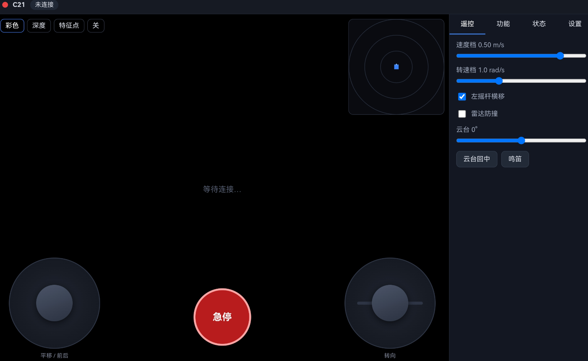
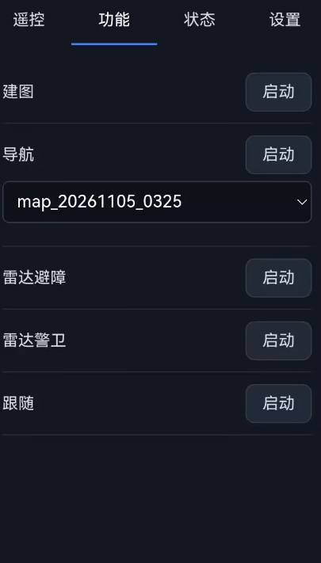
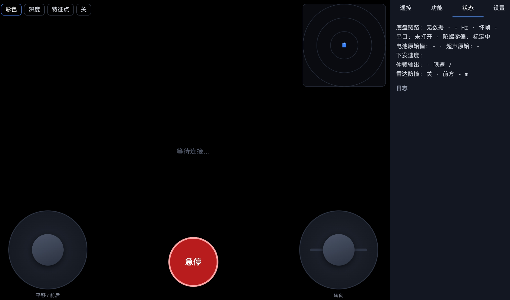
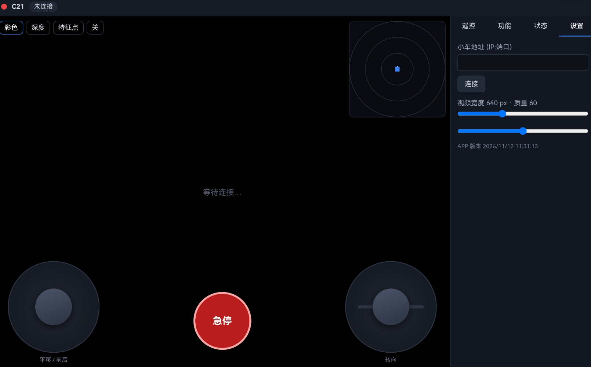

# C21 麦轮 ROS2 智能小车

Jetson Orin NX 上的 ROS2 Humble 全栈 + 平板 APP（Vue 3 + Capacitor）。
小车能遥控、建图、导航与巡航、雷达避障/警卫、视觉跟随人，全部可从 APP 一键启停。

## 硬件

| 部件 | 型号 / 说明 |
| --- | --- |
| 主控 | Jetson Orin NX 16G（Ubuntu 20.04 / L4T 35.5，宿主保留 ROS1 Noetic，ROS2 跑在 Docker 里） |
| 底盘 | C21 麦克纳姆轮（车身约 27 × 25 cm），OpenRF4 下位机（STM32F407） |
| 底盘通信 | 串口 `/dev/ttyTHS0`，115200 8N1；下行速度帧 `AA 55 0B 50 vx vy wz sum`（int16 大端 ×1000），上行 36 字节含 IMU、实测速度、舵机、电压 |
| 雷达 | Slamtec RPLIDAR C1（CP2102N，460800），用 by-id 路径固定设备 |
| 相机 | Orbbec Gemini 336L（USB 3.2，彩色 + 深度） |
| 云台 | 舵机云台（走下位机 0x80 舵机帧） |
| 控制端 | 华为 MatePad（横屏），或任意浏览器打开 `http://小车IP:8080` |
| 网络 | WiFi；车上装有 WiFi 看门狗，网关失联会自动重连当前连接 |

下位机固件不在本仓库，也不需要改动。

## 软件结构

```
app/                      平板 APP（Vue 3 + Vite，Capacitor 打包 Android APK）
  src/App.vue             主界面：遥控、建图、导航、功能模式
  src/components/         Joystick / ScanView（雷达）/ MapView（地图点选、擦除）
release/C21-remote.apk    已编译的调试版 APK
docs/开发方案.md           整体设计与分期计划
jetson/c21_ws/            Jetson 上的 ROS2 工作区
  src/c21_base            串口驱动：里程计、IMU、电压、云台、蜂鸣器
  src/c21_safety          速度仲裁（急停 > APP > 功能 > 导航）、限速限加速度、雷达/深度近距刹停、超时停车
  src/c21_behaviors       雷达避障/警卫、视觉跟随（YOLO 认人 + 颜色特征 + 雷达连续跟踪）
  src/c21_gateway         APP 网关：WebSocket 控制 + MJPEG 视频 + 模式管理 + 地图管理/擦除
  src/c21_bringup         launch 与参数（c21.yaml、nav2.yaml、slam_mapping.yaml、modes.yaml）
  src/c21_description     URDF（含雷达/相机外参）
  docker/Dockerfile       运行镜像（Humble + Nav2 + slam_toolbox + Orbbec 驱动）
  host/                   宿主机上的服务：YOLO 检测（GPU）、WiFi 看门狗
  scripts/c21.sh          构建、启动、日志、测试的入口
```

数据流：APP ⇄ WebSocket/MJPEG ⇄ `c21_gateway` ⇄ ROS2 话题；所有运动指令都经过 `c21_safety` 仲裁，
APP 掉线（心跳租约到期）、急停、传感器近距障碍都会让车停下。

## 功能

| 功能 | 说明 |
| --- | --- |
| 遥控 | 双摇杆（平移 + 旋转）、云台、蜂鸣器、急停、速度上限可调、实时视频与电量 |
| 建图 | slam_toolbox，开车跑一圈，地图实时显示，一键保存（pgm/yaml + 位姿图） |
| 导航 | Nav2 全向导航（AMCL + RegulatedPurePursuit）：地图点选目标并先预览路线、设置起点位姿、记住起点并一键返回 |
| 巡航 | 多点路线，可循环；出发前逐段预检可达性 |
| 地图擦除 | 在地图上划掉建图时误入的障碍（如路人），可恢复原图，改动即时生效 |
| 雷达避障 | 自己往前走，遇障转向更空旷的一侧 |
| 雷达警卫 | 原地不动，记住环境，有新目标靠近就转向并鸣笛 |
| 视觉跟随 | 锁定启动时站在正前方的人，保持约 1 m；被挡时绕行，丢失后按衣着颜色找回 |

## APP 界面

横屏布局：左侧是视频 / 地图主视图（左上切换彩色、深度、特征点，右上是雷达小图），底部是双摇杆和急停；右侧四个标签页：

| 标签 | 内容 |
| --- | --- |
| 遥控 | 速度档、转速档、左摇杆横移、雷达防撞、云台角度、云台回中、鸣笛 |
| 功能 | 建图、导航（可选地图）、雷达避障、雷达警卫、跟随，一键启动 / 停止 |
| 状态 | 底盘链路、串口、陀螺零偏、电池、下发速度、仲裁输出、雷达防撞，以及日志 |
| 设置 | 小车地址（IP:端口）、视频宽度与质量、APP 版本 |

| 遥控 | 功能 |
| --- | --- |
|  |  |

| 状态 | 设置 |
| --- | --- |
|  |  |

## 运行

### 1. 小车端（Jetson 宿主机）

```bash
cd ~/c21_ws
scripts/c21.sh build        # 在运行镜像里 colcon build
scripts/c21.sh up           # 启动底盘、安全层、雷达、相机、网关（容器 c21_robot，开机自启）
scripts/c21.sh logs         # 看日志
scripts/c21.sh test         # 运行单元测试
```

运行镜像由 `docker/Dockerfile` 构建，基础镜像 `c21/ros2-humble:nav` 需要自行准备。
Jetson 访问不了 GitHub/PyPI，Dockerfile 用的是清华镜像。

视觉跟随的人体检测跑在宿主机（容器里没有 GPU 访问），需要 CUDA 版 torch 和 ultralytics：

```bash
cp jetson/c21_ws/host/c21-yolo.service ~/.config/systemd/user/
systemctl --user daemon-reload && systemctl --user enable --now c21-yolo
```

WiFi 看门狗（可选，root）：安装 `host/c21-wifi-watchdog.{sh,service,timer}`，每 30 s 检查一次网络，连续两次不通就重连当前 WiFi。

地图保存在 `~/c21_maps`，网关通过 `maps_dir` 读取。

### 2. APP

```bash
cd app
npm install
npm run dev                          # 浏览器调试
npm run build                        # 生成 dist/，把它放到小车 ~/c21_ws/app_dist，网关会在 :8080 提供
npx cap sync android
cd android && ./gradlew assembleDebug   # 需要 Android SDK，APK 在 app/android/app/build/outputs/apk/debug/
```

直接安装可用 `release/C21-remote.apk`。手机和小车在同一网络，打开 APP 输入小车 IP 即可。

## Demo：一次完整流程

1. **遥控**：连上后用左摇杆平移、右摇杆转向，红色按钮急停。
2. **建图**：切到「建图」，用摇杆沿房间走一圈（人尽量走在车后面，避免留下"路人障碍"），保存为 `room1`。
3. **导航**：启动「导航」模式并选 `room1`，先点「设定当前位置」，用准星和方向键对准车的实际位置，点「确定位置」；
   点「选目标」在地图上选点，先看预览路线，再点「出发」；「回起点」回到记下的起点（可用「把这里设为起点」重设）。
4. **巡航**：「巡航路线」依次点几个点，选择是否循环，预检通过后开始。
5. **地图擦除**：导航页点「擦除」，手指划过地图上的假障碍，点「完成」退出；「恢复原图」撤销所有擦除。
6. **跟随**：站在车正前方 2.5 m 内，开启「跟随」，车锁定你并保持约 1 m。

## 安全约定

- 涉及车轮转动的测试，先架空，再地面低速；默认限速 0.3 m/s、1.0 rad/s。
- 网关心跳（≥5 Hz）丢失、急停、雷达或深度近距障碍都会停车；导航在网络中断时会暂停，15 秒内连回会继续。
- 不要刷写 STM32 固件，不要改宿主机的 ROS1/CUDA 环境。
- 网关默认不设令牌，只应在可信的局域网使用；需要时在参数里设 `token`。
